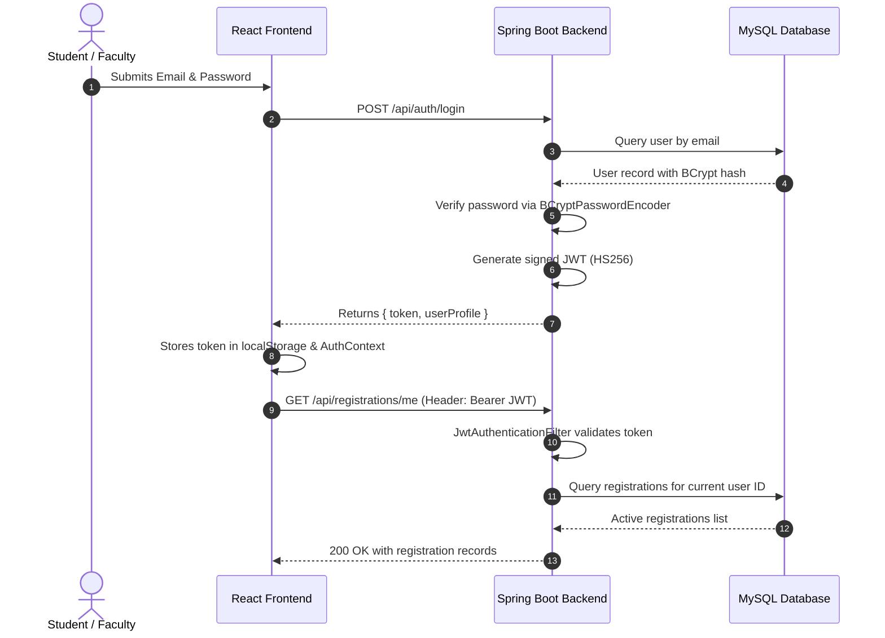

# EventEase System Architecture & Technical Specifications

**Official Title:** Department Seminar and Workshop Management System  
**Institution:** SRM Institute of Science and Technology, Tiruchirappalli Campus  
**Course:** 21CSE354T — Full Stack Web Development  

---

## 1. High-Level Architecture Overview

EventEase is built on a distributed full-stack architecture comprising a React Single Page Application (SPA), a Spring Boot 3 core RESTful backend, a separate Spring Boot Notification microservice, and a MySQL 8.x relational database.

```mermaid
flowchart TD
    subgraph Client_Tier [Client Presentation Tier]
        Browser["React 19 + Vite SPA (Port 5173)\nContext API + CSS Variables Theming"]
    end

    subgraph Core_Backend [Core Backend Tier (Port 8080)]
        Security["Spring Security (JWT Filter + BCrypt)"]
        Controllers["REST Controllers (Auth, Events, Registrations, Attendance)"]
        Services["Service Layer (Business Rules & Transactions)"]
        Repositories["Spring Data JPA Repositories"]
        NotifClient["Notification HTTP Client (RestTemplate)"]

        Security --> Controllers
        Controllers --> Services
        Services --> Repositories
        Services --> NotifClient
    end

    subgraph Microservice_Tier [External Microservice Tier (Port 8082)]
        NotificationService["Notification Service\nPOST /api/notifications/registration-confirmation"]
    end

    subgraph Data_Tier [Data Tier]
        MySQL[("MySQL 8.x (eventease_db)\nInnoDB Engine")]
    end

    Browser -- "HTTP / REST (JSON) + Bearer Token" --> Security
    Repositories -- "JPA / Hibernate (HikariCP)" --> MySQL
    NotifClient -- "HTTP POST (JSON)" --> NotificationService
```

---

## 2. Component Architecture Breakdown

### 2.1 Frontend Tier (`frontend/`)
* **Framework:** React 19 bootstrapped with Vite.
* **State Management:**
  * `ThemeContext`: Controls CSS custom properties (`data-theme="dark"` / `"light"`) with `localStorage` persistence.
  * `AuthContext`: Manages user identity, JWT authentication state, and role checks (`isAdmin`, `isOrganiser`, `isStudent`).
  * `ToastContext`: Global notification queue for async user feedback.
* **Routing & Guards:**
  * `react-router-dom` handles client navigation.
  * `ProtectedRoute.jsx` intercepts unauthenticated sessions.
  * `RoleGuard.jsx` ensures only allowed roles access specialized views (e.g. Admin Panel, Event Management).
* **HTTP Client:**
  * Axios instance (`services/api.js`) configured with base URL interceptors and automatic `Authorization: Bearer <jwt>` injection.

---

### 2.2 Backend Core Service (`backend/`)
* **Framework:** Spring Boot 3.3.4 on Java 21 LTS.
* **Layered Package Structure:**
  * `controller/`: REST API endpoints, request validation (`@Valid`), HTTP status mapping.
  * `service/`: Transactional business logic, capacity calculation, deadline cutoff checks, attendance marking.
  * `repository/`: Spring Data JPA interfaces with derived query methods and custom JPQL.
  * `entity/`: Hibernate `@Entity` models mapped to MySQL relational tables.
  * `dto/`: Separate Request and Response DTOs to encapsulate domain models and prevent mass-assignment vulnerabilities.
  * `security/`: JWT token generation, parsing, validation, and Spring Security filters.
  * `exception/`: `@RestControllerAdvice` centralized error handler converting exceptions to uniform JSON responses.
  * `client/`: External microservice HTTP integration.

---

### 2.3 Notification Microservice (`notification-service/`)
* **Role:** Standalone service deployed on port 8082 to handle asynchronous simulated registration notices.
* **Integration Pattern:**
  * The core backend calls `POST http://localhost:8082/api/notifications/registration-confirmation`.
  * **Fault Tolerance:** If the notification service is offline or unreachable, the core backend logs a warning but **does not fail or roll back the student's valid registration**.

---

### 2.4 Data Tier (`database/`)
* **Database Engine:** MySQL 8.x with InnoDB storage engine.
* **Entities:**
  * `users`: Primary key `id`, unique `email`, hashed `password_hash`, `role` (`ADMIN`, `ORGANISER`, `STUDENT`).
  * `events`: Scheduled seminars/workshops, foreign key to `users(id)` as organizer.
  * `registrations`: Bridge entity linking student and event, status (`CONFIRMED`, `CANCELLED`).
  * `attendances`: One-to-one record with registration, tracking presence (`PRESENT`, `ABSENT`, `NOT_MARKED`).

---

## 3. Security & Authentication Flow



---

## 4. Business Rule Invariants

1. **Role Escalation Prevention:**
   * Public registration (`POST /api/auth/register`) strictly sets `Role.STUDENT`. The incoming role parameter cannot override this policy.
2. **Event Capacity Safeguard:**
   * Registrations are rejected with `400 Bad Request` if `countByEventIdAndStatus(eventId, 'CONFIRMED') >= event.capacity`.
3. **Registration Deadline:**
   * Students cannot register after `event.registrationDeadline < LocalDate.now()`.
4. **Duplicate Registration Prevention:**
   * A student cannot hold more than one active `CONFIRMED` registration for the same event.
5. **Event Schedule Consistency:**
   * Event end time must be chronologically after the start time (`end_time > start_time`).
   * Registration deadline must be on or before the event date (`registration_deadline <= event_date`).
6. **Cancellation vs. Audit Trail:**
   * Historical registration records are soft-cancelled (`status = 'CANCELLED'`) rather than permanently deleted, ensuring historical faculty attendance reporting remains intact.
