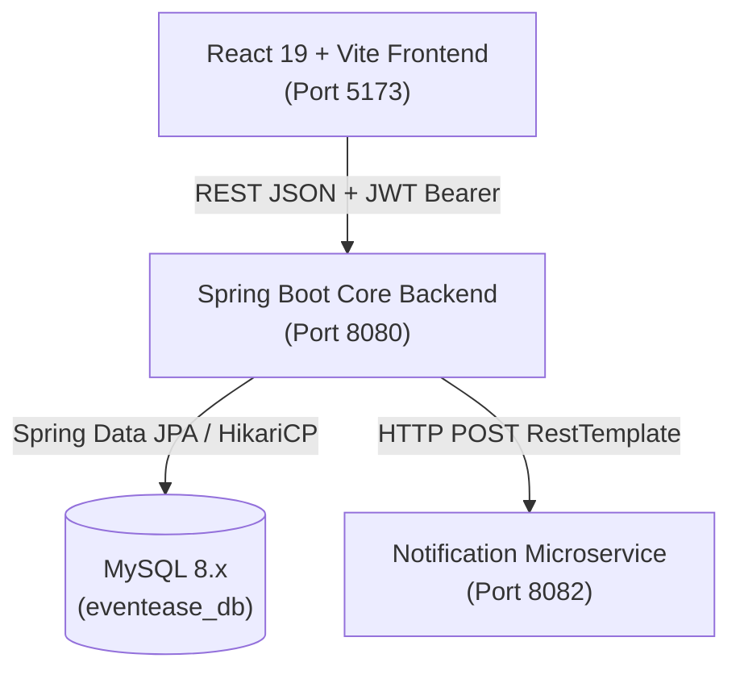

# EventEase — Department Seminar and Workshop Management System

**Tagline:** *Smarter Events. Simpler Experiences.*  
**Course:** 21CSE354T — Full Stack Web Development  
**Institution:** SRM Institute of Science and Technology, Tiruchirappalli Campus  
**Department:** Computer Science and Engineering  

---

## 1. Project Overview

**EventEase** is a web-based management platform designed for college academic departments to organize, discover, and coordinate technical seminars, faculty guest lectures, and coding masterclasses.

* **Students** can browse upcoming events, inspect agendas and speaker profiles, reserve seats within capacity limits, track their enrollment history, and view verified attendance records.
* **Faculty Organizers** can create and schedule workshops, configure registration deadlines, manage student participant rosters, and mark attendance records.
* **Department Administrators** have complete governance over user roles, account activation statuses, system-wide statistics, and institutional audit reports.

---

## 2. Problem Statement

Departmental seminars and workshops frequently suffer from:
1. Disorganized registration via generic spreadsheets, causing overbooking and seat quota discrepancies.
2. Lack of automated capacity enforcement and deadline cutoffs.
3. Cumbersome manual paper attendance sheets that are lost or difficult to aggregate for NAAC/NBA accreditation.
4. Absence of a centralized, responsive dashboard where students can discover events across different computing specializations.

**EventEase** solves these problems by providing an integrated, role-based platform with real-time seat availability, automated capacity tracking, fault-tolerant notification simulation, and verified attendance logging.

---

## 3. Project Objectives

* Develop a modern, responsive Single Page Application with persistent light/dark theming and blue-violet gradient design tokens.
* Implement a robust, layered Spring Boot 3 RESTful backend with BCrypt password hashing and stateless JWT token authentication.
* Model a normalized MySQL 8.x relational schema enforcing foreign keys, unique constraints, and check constraints.
* Integrate a separate Spring Boot Notification microservice to demonstrate distributed inter-service communication.
* Provide an automated JUnit 5 / MockMvc test suite verifying validation invariants, seat limits, and controller endpoints.

---

## 4. Main Features

* **Visual Identity & Dark Mode:** Complete light and dark theme toggle with instant `localStorage` persistence and glassmorphism cards.
* **Role-Based Access Control (RBAC):** Distinct interfaces and backend-enforced API permissions for `ADMIN`, `ORGANISER`, and `STUDENT`.
* **Event Catalogue & Explorer:** Live keyword search, category filtering (Seminar / Workshop), status filtering, and capacity bars.
* **Real Seat Reservation Workflow:** Atomic capacity checks, deadline verification, and duplicate registration prevention.
* **Simulated Notification Microservice:** External HTTP REST integration with fault-tolerant fallback if the notification service is offline.
* **Live Attendance Tracking:** Fast participant search, single-click Present/Absent marking, and automated attendance percentage computation.
* **Analytics & CSV Export:** Visual Recharts bar and pie distributions with downloadable CSV audit reports.

---

## 5. User Roles and Privileges

| Feature / Action | `STUDENT` | `ORGANISER` | `ADMIN` |
| :--- | :---: | :---: | :---: |
| Browse & Search Events | ✅ | ✅ | ✅ |
| View Event Specifications & Agenda | ✅ | ✅ | ✅ |
| Register for Open Events | ✅ | ❌ | ❌ |
| Cancel Eligible Registrations | ✅ | ✅ | ✅ |
| View My Enrolled Events & Attendance | ✅ | ❌ | ❌ |
| Author & Publish New Events | ❌ | ✅ | ✅ |
| Modify Managed Events | ❌ | ✅ (Own) | ✅ (All) |
| Cancel Scheduled Events | ❌ | ✅ (Own) | ✅ (All) |
| Mark Participant Attendance | ❌ | ✅ (Own) | ✅ (All) |
| System User Role Management | ❌ | ❌ | ✅ |
| Deactivate / Activate Accounts | ❌ | ❌ | ✅ |
| Export Department CSV Reports | ❌ | ✅ | ✅ |

---

## 6. Technology Stack

### Frontend
* **Core:** React 19, JavaScript ES6+, HTML5
* **Styling:** Vanilla CSS3 with CSS Custom Properties (Theme tokens, Gradients, Glassmorphism)
* **Build Tool:** Vite
* **Routing:** React Router DOM (v7)
* **HTTP Client:** Axios with JWT request interceptors
* **Icons:** Lucide React
* **Charts:** Recharts
* **State Management:** React Context API (`AuthContext`, `ThemeContext`, `ToastContext`)

### Backend
* **Runtime:** Java 21 LTS
* **Framework:** Spring Boot 3.3.4
* **Security:** Spring Security with stateless JWT (`jjwt` 0.12.6) and BCrypt
* **ORM:** Spring Data JPA / Hibernate 6.5
* **Validation:** Jakarta Bean Validation (`hibernate-validator`)
* **Testing:** JUnit 5, Mockito, Spring Boot Test, MockMvc
* **Build Tool:** Apache Maven (Maven Wrapper included)

### Database & External Services
* **Database:** MySQL 8.x (`eventease_db`) with InnoDB engine
* **Fallback & Testing:** In-memory H2 Database for isolated test execution
* **Separate Microservice:** Spring Boot Notification Service (Port 8082)

---

## 7. Architecture Overview



---

## 8. Database Design (`eventease_db`)

The relational schema is defined in `database/schema.sql`:

1. **`users`**: User identity, hashed credentials, department, and role (`ADMIN`, `ORGANISER`, `STUDENT`).
2. **`events`**: Event titles, agendas, categories (`Seminar`, `Workshop`), schedule, venue, capacity, deadlines, status (`UPCOMING`, `ONGOING`, `COMPLETED`, `CANCELLED`), and organizer reference.
3. **`registrations`**: Student enrollment records with status (`CONFIRMED`, `CANCELLED`).
4. **`attendances`**: One-to-one record linked to registrations with attendance status (`PRESENT`, `ABSENT`, `NOT_MARKED`), marker ID, and timestamp.

---

## 9. Folder Structure

```text
EventEase/
├── backend/                       # Spring Boot Core REST API
│   ├── src/main/java/com/eventease/
│   │   ├── client/                # Microservice RestTemplate client
│   │   ├── config/                # CORS, DataInitializer, WebConfig
│   │   ├── controller/            # REST Controllers
│   │   ├── dto/                   # Request & Response DTOs
│   │   ├── entity/                # Hibernate JPA Entities & Enums
│   │   ├── exception/             # Centralized @RestControllerAdvice
│   │   ├── repository/            # Spring Data JPA Repositories
│   │   ├── security/              # JWT Provider & Security Filters
│   │   └── service/               # Domain Business Logic & Transactions
│   ├── src/main/resources/        # application.properties
│   ├── src/test/java/             # JUnit 5 & MockMvc Tests
│   └── pom.xml
├── frontend/                      # React 19 + Vite SPA
│   ├── src/
│   │   ├── components/            # Navbar, Footer, EventCard, StatCard, Modals
│   │   ├── context/               # AuthContext, ThemeContext, ToastContext
│   │   ├── pages/                 # 14 Full Application Views
│   │   ├── services/              # Axios API service modules
│   │   ├── index.css              # Central Design System & CSS Tokens
│   │   ├── App.jsx                # Router & Protected Route Guards
│   │   └── main.jsx
│   ├── package.json
│   └── index.html
├── notification-service/          # Standalone Notification Microservice
│   ├── src/main/java/com/eventease/notification/
│   ├── src/test/java/
│   └── pom.xml
├── database/                      # Relational Database Scripts
│   ├── schema.sql                 # MySQL 8 DDL with Constraints & Indexes
│   └── seed.sql                   # Initial Demo Accounts & Events
├── docs/                          # Course Documentation
│   ├── ARCHITECTURE.md
│   ├── API_DOCUMENTATION.md
│   ├── SQL_CONCEPTS.md
│   ├── TESTING.md
│   ├── DEPLOYMENT.md
│   └── COURSE_OUTCOME_MAPPING.md
├── .env.example                   # Environment configuration template
├── .gitignore
└── README.md
```

---

## 10. Prerequisites

Ensure your system has:
* **Java 21 LTS**
* **Node.js v18+ / v20+ / v24+** and **npm**
* **MySQL Server 8.x** (optional for test mode; required for live MySQL demonstration)

---

## 11. Step-by-Step Setup & How to Run

EventEase supports two operational modes:
1. **Zero-Setup Standalone Demo Mode (Default):** Runs immediately with automatic disk-persisted database in MySQL 8 compatibility mode, auto-seeding users and events. No external database installation needed!
2. **Live MySQL 8.x Mode:** Runs against your local MySQL Server daemon using `database/schema.sql` and `database/seed.sql`.

---

### Mode A: Standalone Demo Mode (Recommended for Grading & Fast Testing)

No MySQL server installation is required.

#### Step 1: Start Main Backend (Port 8080)
```powershell
cd backend
.\mvnw.cmd spring-boot:run
```
*The backend initializes, seeds all demo accounts and events, and listens on `http://localhost:8080/api`.*

#### Step 2: Start Notification Microservice (Port 8082 - Optional)
```powershell
cd notification-service
.\mvnw.cmd spring-boot:run
```
*Health endpoint:* `http://localhost:8082/api/notifications/health`

#### Step 3: Start Frontend SPA (Port 5173)
```powershell
cd frontend
npm run dev
```
Open your browser at: **`http://localhost:5173`**

---

### Mode B: Live MySQL 8.x Server Mode

Use this if you have MySQL Server installed and running locally on port 3306.

#### Step 1: Initialize Database
```bash
mysql -u root -p
source /path/to/EventEase/database/schema.sql;
source /path/to/EventEase/database/seed.sql;
```

#### Step 2: Configure Environment
Copy `.env.example` to `.env` or set your MySQL password:
```env
DB_HOST=localhost
DB_PORT=3306
DB_NAME=eventease_db
DB_USERNAME=root
DB_PASSWORD=your_mysql_password
SPRING_PROFILES_ACTIVE=mysql
```

#### Step 3: Start Services
```powershell
# Terminal 1: Notification Microservice
cd notification-service
.\mvnw.cmd spring-boot:run

# Terminal 2: Main Backend with MySQL Profile
cd backend
.\mvnw.cmd spring-boot:run -Dspring-boot.run.profiles=mysql

# Terminal 3: Frontend Client
cd frontend
npm run dev
```
Open your browser at: **`http://localhost:5173`**

---

## 12. Pre-Configured Demonstration Accounts

All pre-seeded demo accounts share the password: `password123`

| Role | Name | Email | Password |
| :--- | :--- | :--- | :--- |
| **ADMIN** | Dr. Rajesh Sundaram | `admin@eventease.srmist.edu.in` | `password123` |
| **ORGANISER** | Prof. Ananya Sharma | `ananya.cse@eventease.srmist.edu.in` | `password123` |
| **ORGANISER** | Dr. Karthik Raman | `karthik.ai@eventease.srmist.edu.in` | `password123` |
| **STUDENT** | Aarav Patel | `aarav.student@eventease.srmist.edu.in` | `password123` |
| **STUDENT** | Diya Sen | `diya.student@eventease.srmist.edu.in` | `password123` |
| **STUDENT** | Rohan Verma | `rohan.student@eventease.srmist.edu.in` | `password123` |

*(Tip: On the Login page, click any of the **Quick Demo Login** chips to instantly populate credentials).*

---

## 13. Running Automated Tests

### Core Backend Tests (11 Tests)
```powershell
cd backend
.\mvnw.cmd test
```
*Result: 11 tests run, 0 failures, 0 errors (BUILD SUCCESS).*

### Notification Service Tests (2 Tests)
```powershell
cd notification-service
.\mvnw.cmd test
```
*Result: 2 tests run, 0 failures, 0 errors (BUILD SUCCESS).*

### Frontend Production Build
```powershell
cd frontend
npm run build
```
*Result: 2,607 modules transformed, production assets compiled in 1.34s.*

---

## 14. Demo Walkthrough Instructions

1. **Visitor:** Open `http://localhost:5173` to explore the Landing Page, statistics, and featured events.
2. **Student Registration:** Click **Get Started**, register an account, and observe automatic assignment to the `STUDENT` role.
3. **Event Booking:** Browse `/events`, select an event, click **Register for Event**, and verify seat availability decrements immediately.
4. **My Registrations:** Visit `/student/registrations` to view your booking. Try cancelling to observe the released seat.
5. **Faculty Experience:** Sign in as `ananya.cse@eventease.srmist.edu.in`.
   * Create an event at `/organizer/events/new`.
   * Open `/organizer/attendance`, pick an event, and mark students **Present** or **Absent**.
6. **Administrator Experience:** Sign in as `admin@eventease.srmist.edu.in`.
   * Navigate to `/admin/dashboard` to inspect system user roles and toggle account activation.
   * Navigate to `/reports` and click **Export CSV Report**.
7. **Theming:** Click the Sun/Moon icon in the navbar. Refresh the page to confirm dark/light theme persistence.

---

## 15. Team Contributions (CSE Department)

| Team Member | Register Number | Role & Modules Handled |
| :--- | :--- | :--- |
| **Student 1 (Lead)** | `RA2311003010xxx` | Full-stack architecture, Spring Security, JWT filters, Database schema |
| **Student 2** | `RA2311003010xxx` | React components, CSS variables design tokens, Landing page, Theming |
| **Student 3** | `RA2311003010xxx` | Event CRUD, Seat capacity safeguards, Notification microservice client |
| **Student 4** | `RA2311003010xxx` | Attendance marking system, Recharts reporting, JUnit 5 automated test suite |

---

## 16. Screenshots Placeholders

| Section | Description | File Path |
| :--- | :--- | :--- |
| **Hero & Landing Page** | Gradient hero, trust statistics, and featured cards | `docs/screenshots/landing_dark.png` |
| **Light Theme** | Clean light mode appearance across catalogue | `docs/screenshots/landing_light.png` |
| **Event Details** | Real-time seat capacity bar & registration action | `docs/screenshots/event_details.png` |
| **Student Dashboard** | Enrolled events, schedule, and attendance badges | `docs/screenshots/student_dashboard.png` |
| **Attendance Roster** | Faculty one-click attendance marking and KPI rates | `docs/screenshots/attendance_roster.png` |
| **Reports & Recharts** | Department participation charts and CSV download | `docs/screenshots/reports_analytics.png` |
| **Admin Panel** | User role assignment and account governance | `docs/screenshots/admin_dashboard.png` |

---

## 17. Limitations and Future Enhancements

* **Current Limitation:** Email confirmations are simulated by the notification microservice with masked emails and logs, as third-party SMTP servers require authenticated institutional credentials.
* **Future Enhancement 1:** Automatic generation of digitally signed PDF certificates of participation upon marking attendance as `PRESENT`.
* **Future Enhancement 2:** QR-code check-in scanner on mobile devices for organizers at physical auditorium entrances.
* **Future Enhancement 3:** Integration with institutional Single Sign-On (SSO) via OAuth2 / SAML.

---

## 18. Project Certification

This project was developed for the course **21CSE354T — Full Stack Web Development** at **SRM Institute of Science and Technology, Tiruchirappalli Campus**, demonstrating mastery of HTML5, CSS3, React.js, MySQL, Spring Boot 3, Spring Data JPA, and RESTful microservice architectures.
